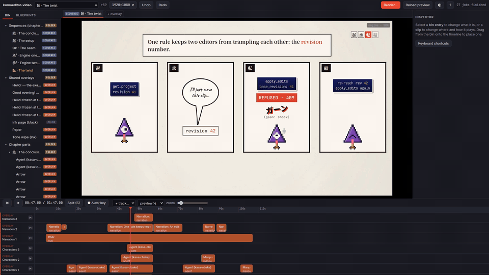

# kuma-editor

A video editor you share with an AI agent.

You cut footage on a normal timeline. The titles, labels, speech bubbles and animated
explanations on top of it are small web pages (HTML/CSS/JS). And your coding agent sits in
the same project over MCP: it reads the timeline, makes edits, writes overlays, and **looks at
the rendered frames** to check its own work. You see every change live and can undo any of
them.


- ▶ **[How the editor works](https://youtu.be/MIhg9J0PoT4)** (video walkthrough)
- ▶ **[Something made with it](https://youtu.be/t06FCkF8cQY)** (a remake of
  [this video](https://youtu.be/ubD6C20NhGk))

> **Status: proof of concept.** Linux only, built for one person's workflow, and it will
> change without notice. Expect rough edges.

## What's inside

- **Video:** [MLT](https://www.mltframework.org/), the engine behind Kdenlive and Shotcut.
  Cuts, speed, crop, transform, dissolves and wipes, colour, blur, keyframes, audio mixing,
  nested sequences. Projects export to `.mlt`, which Kdenlive can open.
- **Overlays:** each one is a folder with an `index.html`. While you edit, it runs live in
  the preview; at export, [hyperframes](https://github.com/heygen-com/hyperframes) renders
  it frame by frame to video with transparency: any length, any resolution, the same result
  every time.
- **Agent:** the whole project is one JSON file. An MCP server lets a coding agent edit it,
  and every edit is one undoable step in the same history as yours.
- **Subtitles:** transcribe speech locally with [whisper.cpp](https://github.com/ggml-org/whisper.cpp),
  one cue per word, styled like any other overlay.


## Install

You need Linux (developed on Ubuntu), [Rust](https://rustup.rs/), Node.js 22+ and these
packages:

```sh
sudo apt install ffmpeg melt libmlt-dev libmlt++-dev libsdl2-dev libturbojpeg0-dev cmake xvfb
```

Then build everything:

```sh
git clone https://github.com/Raffaelbdl/kuma-editor.git
cd kuma-editor
npm run rebuild      # builds kuma, the editor, the desktop app, the preview engine and whisper.cpp,
                     # installs `kuma` into ~/.cargo/bin, then runs `kuma doctor`
kuma library         # installs the starter overlays, presets and fonts into ~/.local/share/kuma
```

`kuma doctor` tells you what is missing. The preview engine and whisper.cpp are optional:
without the engine, scrubbing still works but playback does not; without whisper.cpp,
there are no subtitles.

**Run `npm run rebuild` again after every `git pull`.** The binary and the built UI are not
in git, and an old one fails in confusing ways.

## Use it

### The desktop app

```sh
npm run app
```

The launcher lets you create or open a project. A project is a folder holding a
`<name>.kuma.json` file and your media. Drag files into the window to add them to the bin,
drag bin entries onto the timeline, edit in the inspector on the right, and press
**Render**. Videos land in the project's `renders/` folder.



You can also skip the app and use a browser: run `kuma serve` in a project folder and open
<http://127.0.0.1:7455>. `kuma servers` lists every daemon running on the machine — the
app's, an agent's, yours — with the address to open each one's editor at.

### With a coding agent

kuma works with any coding harness that reads a project-level `.mcp.json` in the format
Claude Code uses. Every project comes with one, plus a `kuma-video` skill in
`.claude/skills/`, so it's enough to start your agent in the project folder and approve the
`kuma` server when asked (with Claude Code: run `claude`). If the editor is open on that
project, the agent joins it and you watch its edits appear.

Ask for things the way you would ask a person: *"cut the silences"*, *"add a title that
says Day 1"*, *"put subtitles on the interview"*, *"make the speech bubble warmer"*.


Each edit the agent makes is a single [JSON Patch](https://jsonpatch.com/). It applies
completely or not at all, and you can undo it like one of your own:


You and the agent can work at the same time. Each edit names the revision of the project
it was based on, and an edit based on an old revision is refused instead of overwriting
yours:


To add kuma to an existing project, run `kuma mcp-config` in its folder.

### From the command line

```sh
kuma init --project myvideo.kuma.json --fps 30   # --width 1080 --height 1920 for vertical
kuma add-media media/clip.mp4
kuma serve                                       # the editor at http://127.0.0.1:7455
kuma servers                                     # every running daemon: its URL and project
kuma render --preset youtube-1080p               # bake overlays and export
kuma transcribe --clip c1                        # subtitles for clip c1
kuma sample 12 14 --count 4                      # save a few frames to look at
kuma --help                                      # everything else
```

If you run `kuma` outside the repository, set `KUMA_REPO=/path/to/kuma-editor` so it can
find the editor and its tools.

## Making overlays

An overlay is a folder in your project, `overlays/<name>/`, with an `index.html` and an
`overlay.json` that lists its settings (text, colours, fonts…), which the inspector turns
into fields. The animation is a [GSAP](https://gsap.com/) timeline that kuma can seek to
any frame.

**Blueprints** are reusable overlays kept in your library (`~/.local/share/kuma/blueprints`).
Using one copies it into the project, so changing a blueprint later never changes a
finished video. The starter set has titles, lower thirds, location tags, callout arrows,
a countdown, a hand-drawn paint wipe, a watermark and subtitles.

To write one yourself, `kuma new-overlay my-thing` creates a working skeleton and
`kuma lint overlays/my-thing` checks it. The rules an overlay has to follow are in
[`library/blueprints/CLAUDE.md`](library/blueprints/CLAUDE.md). Or ask the agent to write
it: that is the part it does best.

## If something goes wrong

- **Start with `kuma doctor`.** It checks the binary, the tools, the preview engine, the
  display, and whether an editor is already running.
- **Just pulled?** Run `npm run rebuild`.
- **Your agent can't connect to kuma:** run the command from `.mcp.json` yourself
  (`kuma mcp --project <file>`) to see the error, then reconnect (`/mcp` in Claude Code).
- **The preview is blurry:** it runs at half resolution for speed; choose `preview full`
  under the viewer.
- **No display (SSH, CI):** install `xvfb`; kuma uses it automatically.
- **`.kuma/` keeps growing:** `kuma cache prune` deletes old overlay bakes and frames.

The [manual](docs/manual.md) covers every feature, the CLI, the project file format, all
the MCP tools and more troubleshooting. [`docs/decisions.md`](docs/decisions.md) explains
why things are built the way they are.

## Licence

[MIT](LICENSE). kuma runs MLT (LGPL), ffmpeg and melt as separate programs, and uses hyperframes
(Apache-2.0) and GSAP (under its own licence).
